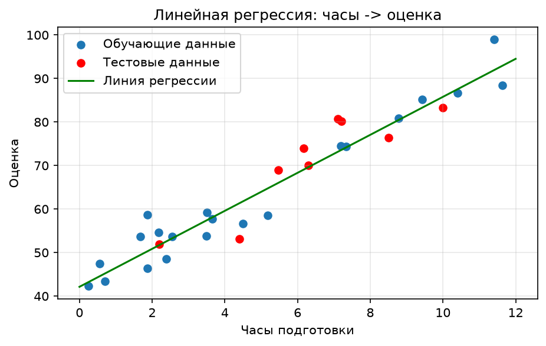

# Лабораторная работа № 19: Введение в машинное обучение (Линейная регрессия и kNN)

**Дисциплина:** ДУП.03 «Основы программирования на языке Python»  
**Выполнил:** Мерзляков Данил Андреевич, Группа ИИ13/9  
**Проверил:** Дрыгваль Валерия Станиславовна

## Описание проекта
В работе реализованы два базовых алгоритма обучения с учителем с использованием библиотеки `scikit-learn`:
- **Линейная регрессия (`LinearRegression`):** предсказание оценки за экзамен на основе часов подготовки.
- **Классификация (`KNeighborsClassifier`):** предсказание покупки подписки пользователем по возрасту и активности в приложении.

## Полученные метрики
- **Наклон (k):** `4.37` (каждый дополнительный час подготовки прибавляет ~4.37 балла)
- **Свободный член (b):** `42.13` (базовый уровень баллов без подготовки)
- **MAE (средняя абсолютная ошибка):** `3.98` балла (отличный результат для 100-балльной шкалы)
- **Accuracy kNN (n_neighbors=3):** `0.67` (модель верно классифицировала 67% тестовых пользователей)

## График регрессии

## Как запустить
1. Установите зависимости: `pip3 install -r requirements.txt`
2. Запустите скрипт: `python3 main.py`
